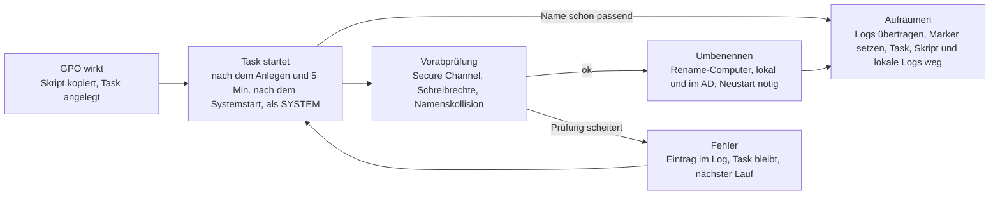

# HostRename – Betriebsdokumentation

[English version](README.md)

Version 1.2.0 · Stand: 3. November 2026

## Überblick

HostRename benennt domänengebundene Windows-Clients automatisch um und benennt dabei auch das zugehörige AD-Computerobjekt um. Die aktuelle Umbenennungslogik bildet den neuen Namen aus einer Vorlage: Prefix und Suffix um den bestehenden Namen und/oder die Seriennummer des Geräts. Standardmäßig wird ein festes Prefix vorangestellt (`PC1234` wird zu `NG-PC1234`); Namen über 15 Zeichen werden gekürzt oder übersprungen.

Verteilt wird per GPO: Sie kopiert das Skript von einem zentralen Share auf den Client und legt dort einen Scheduled Task an. Nach erfolgreicher Umbenennung entfernen sich Task, Skript und lokale Logdateien selbst wieder. Jeder Schritt landet in einem zentralen CSV-Log, das sich pro Gerät filtern lässt. Alternativ kann das Verteilwerkzeug ACMP die Skripte ausführen (siehe „Verteilung über ACMP“); GPO und ACMP sind alternative Verfahren und laufen nie auf demselben Gerät.

Der Produktname ist bewusst neutral: Die Umbenennungsregel steckt nur in `Invoke-HostRename.ps1` und kann später ausgetauscht werden, ohne Share, Delegation, GPO-Hülle und Logging anzufassen.

## Komponenten

HostRename besteht aus zwei Skripten (Preparation und Client), zwei wiederverwendbaren Bausteinen (Netzwerk-Gate, Zertifikatserneuerung), einem ACMP-Wrapper, sechs Pester-Testdateien und einer Beispiel-Konfiguration für die Tests. Jedes Skript hat eine eingebaute Hilfe mit allen Parametern und Beispielen, etwa `Get-Help .\Prepare-HostRename.ps1 -Full`. Skripte, Tests und Beispiel-Konfiguration liegen bewusst gemeinsam im Wurzelverzeichnis des Repositorys: Sie finden einander über ihren Ordner, und das Preparation-Skript schreibt die Test-Konfiguration daneben.

| Datei | Zweck | Ausführung |
| --- | --- | --- |
| `Prepare-HostRename.ps1` | Preparation: legt Share, AD-Delegation und GPO an oder entfernt sie (`-Action Setup` oder `Remove`). Prüft die Umbenennungsregel und zeigt Beispielnamen. Mehrere OUs möglich, einzelne per -OuDN. Optional am Ende eine Bereinigungs-GPO (`-Component CleanupGpo`). Alle Pfade als Variablen, schreibt `HostRename.Checks.psd1` | `Share` auf dem Fileserver; `Delegation`, `Gpo` und `CleanupGpo` auf einem Admin-PC mit RSAT oder einem DC (siehe „Share und GPO auf getrennten Maschinen“); einmalig, erhöhte PowerShell |
| `Invoke-HostRename.ps1` | Client-Skript: Vorabprüfungen, Umbenennung nach Namensvorlage (Prefix, Suffix, Seriennummer), Logging, Selbstbereinigung; `-Deployment Gpo` (Standard) oder `Acmp` | Client, per Scheduled Task als SYSTEM (GPO) oder vom ACMP-Agent als SYSTEM ausgeführt |
| `Test-DeploymentNetwork.ps1` | Netzwerk-Gate: stellt fest, ob das Gerät die Domäne über LAN-Kabel, DirectAccess oder nur über das Firmen-WLAN erreicht; Exit-Code 0/20/21/22/1 und eine Zusammenfassungszeile. Eigenständig, wiederverwendbar | Client, als SYSTEM vor einer Aktion (ACMP) |
| `Update-ComputerCertificate.ps1` | Fordert ein neues Computerzertifikat einer Vorlage an, wenn das vorhandene den aktuellen DNS-Namen nicht trägt (nach einer Umbenennung); `-RemoveOld` entfernt veraltete. Eigenständig, wiederverwendbar | Client, als SYSTEM nach dem Neustart (ACMP) |
| `Invoke-AcmpHostRename.ps1` | ACMP-Wrapper: führt den ganzen Ablauf des ACMP-Client-Commands (Zustandsprüfung, Gate, Umbenennung, Zertifikat, Cleanup) in einem Skriptlauf aus und ruft dazu die drei Skripte oben unverändert auf; eine Zusammenfassungszeile und ein Exit-Code für ACMP (0, 3010, 20, 21, 22, 1, 2, 4, 5) | Client, vom ACMP-Agent als SYSTEM ausgeführt (64-Bit-PowerShell) |
| `HostRename.Checks.psd1` | Konfiguration der Tests. Wird beim Setup vom Preparation-Skript geschrieben und ist deshalb nicht im Repository (`.gitignore`); `HostRename.Checks.beispiel.psd1` zeigt den Aufbau | neben den Testdateien |
| `HostRename.Dc.Tests.ps1` | Pester: Schema, Delegation, GPO/SYSVOL, Shares (nur lesend) | DC oder Admin-PC |
| `HostRename.Client.Tests.ps1` | Pester: SYSTEM-Kontext, Rechteprüfung, Shares, GPO-Anwendung, Vorschau des Zielnamens, Deployment-Zustand | Pilot-Client |
| `HostRename.Local.Tests.ps1` | Pester: Syntax, CSE-GUIDs, icacls, Selbstlöschung eines Tasks, Namensvorlagen, Seriennummern-Bewertung, Zukunfts-ID | DC und Client |
| `HostRename.Network.Tests.ps1` | Pester (Mocks): Netzwerk-Gate, Erkennung und Exit-Codes | beliebiger Rechner, kein AD nötig |
| `HostRename.Certificate.Tests.ps1` | Pester (Mocks): Zertifikatserneuerung | beliebiger Rechner, kein AD und keine CA nötig |
| `HostRename.Acmp.Tests.ps1` | Pester (Mocks): ACMP-Modus, optionales zentrales Log, Berichtswerte | beliebiger Rechner, kein AD nötig |
| `HostRename.Simulation.Tests.ps1` | Pester (Simulation): der ACMP-Client-Command von Anfang bis Ende mit den echten Skripten | beliebiger Rechner, kein AD nötig |

Namen im System:

| Objekt | Name |
| --- | --- |
| GPO | `COMP - HostRename` |
| Bereinigungs-GPO (optional, am Ende) | `COMP - HostRename Cleanup` |
| Scheduled Task | `HostRename` |
| Share (Server) | `\\<Server>\HostRename$` auf `C:\HostRename` mit den Ordnern `scripts` und `log` |
| Lokaler Ordner (Client) | `C:\Program Files\HostRename` |
| Registry-Marker (Client) | `HKLM\SOFTWARE\HostRename` |
| Zentrales Log | `\\<Server>\HostRename$\log\rename-log.csv` |
| Lokales Log (Client) | `C:\Program Files\HostRename\rename-local.csv` (ACMP-Modus: `C:\ProgramData\HostRename\rename-local.csv`) |
| Zustand und Berichtswerte (Client) | `HKLM\SOFTWARE\HostRenameState` mit Ursprungsname, Zielname, Vorlage und den Berichtswerten des letzten Laufs |

## Funktionsweise

Jedes Gerät wird genau einmal umbenannt; danach entfernt sich HostRename selbst.



Ablauf pro Gerät in Worten: GPO wirkt (Skript kopiert, Task angelegt) → Task startet (sofort nach dem Anlegen und 5 Minuten nach jedem Systemstart, als SYSTEM) → Vorabprüfung (Secure Channel, Schreibrechte, Namenskollision) → Umbenennen (`Rename-Computer`, lokal und im AD, Neustart nötig) → Aufräumen (Logs übertragen, Marker setzen, Task, Skript und lokale Logs entfernen). Entspricht der Name schon der Vorlage, springt der Task direkt zum Aufräumen. Scheitert eine Prüfung, schreibt er einen Fehler ins Log und läuft beim nächsten Mal erneut.

Bei Vorlagen mit {Serial} ermittelt der Task zuerst die Seriennummer (bei Problemen eine Zukunfts-ID). Vor jeder Änderung prüft er den Secure Channel, die Schreibrechte auf dem eigenen AD-Objekt und die Namenskollision im AD.

Ergibt die Vorlage mehr als 15 Zeichen, kürzt er nur die Platzhalter-Werte (Standard: hinten, `TruncateEnd`) und loggt das als `TRUNCATE`. Die Bereinigung läuft erst, wenn alle Logzeilen auf dem Share angekommen sind. Sie setzt zuerst den Registry-Marker, damit die GPO Task und Skript nicht neu anlegt. Danach löscht sie Task und Skript. Die lokalen Logdateien und den leeren Ordner entfernt sie erst, wenn auch der letzte Eintrag (`CLEANUP_DONE`) auf dem Share angekommen ist; hängt die Zustellung, bleiben die lokalen Logs als Nachweis erhalten.

## Namensvorlagen

Die Umbenennungsregel ist eine Vorlage mit den Platzhaltern `{Name}` (bisheriger Hostname) und `{Serial}` (Seriennummer). Sie steht in `Prepare-HostRename.ps1` als `$NameTemplate`; ohne Vorlage gilt `$Prefix` und `$Suffix` um den bisherigen Namen.

| Vorlage | Ergebnis für `PC349219` mit Seriennummer `PF2ABCDE` |
| --- | --- |
| `DE{Serial}` | `DEPF2ABCDE` |
| `NG-{Name}` (entspricht `$Prefix = 'NG-'`) | `NG-PC349219` |
| `{Name}-W11` (entspricht `$Suffix = '-W11'`) | `PC349219-W11` |
| `DE-{Serial:-6}` | `DE-2ABCDE` |
| `DE{Serial}-{Name:-4}` | `DEPF2ABCDE-9219` |

- **Länge pro Platzhalter:** `{Serial:8}` nimmt die ersten 8, `{Serial:-8}` die letzten 8 Zeichen; ebenso `{Name:4}` und `{Name:-4}`.
- **Seriennummer:** Sie kommt aus dem BIOS, sonst aus dem System-Produkt, sonst vom Mainboard und enthält nur A–Z und 0–9. Herstellerplatzhalter wie „To Be Filled By O.E.M.“ oder „Default string“, Werte unter 4 Zeichen und Werte aus nur einem Zeichen werden verworfen. Gibt es keine verwendbare, greift die Zukunfts-ID (siehe unten; Event `SERIAL_FALLBACK`). Bei virtuellen Maschinen können Seriennummern lang oder nicht eindeutig sein.
- **Kürzen:** Gekürzt werden nur die Werte der Platzhalter, der letzte zuerst: bei `TruncateEnd` hinten, bei `TruncateStart` vorne. Feste Zeichen der Vorlage bleiben erhalten.
- **Zielname:** höchstens 15 Zeichen aus A–Z, 0–9, `_` und `-`; er beginnt und endet nicht mit `-` und besteht nicht nur aus Ziffern. Die Kollisionsprüfung im AD gilt für den fertigen Namen; bei Vorlagen ohne {Serial} führt ein bereits vergebener Name zu `COLLISION`.
- **Bereits umbenannte Geräte:** Bei Prefix und Suffix erkennt das Skript sie am Muster, bei Vorlagen ohne `{Name}` am berechneten Zielnamen. Bei Vorlagen mit `{Name}` und `{Serial}` merkt es sich Ursprungs- und Zielname in `HKLM\SOFTWARE\HostRenameState`.
- **Zukunfts-ID:** Ist die Seriennummer nicht verwendbar oder der Zielname im AD schon vergeben (doppelte Seriennummer), ersetzt eine generierte ID den Platzhalter `{Serial}`. Sie hat standardmäßig 8 Zeichen aus A–Z ohne I und O sowie 2–9 und wird stabil aus der MachineGuid berechnet; derselbe Rechner erhält also immer dieselbe ID. Ist auch der Name mit der ID vergeben, bildet das Skript mit dem nächsten Zähler eine neue ID (bis zu 5 Versuche, danach `COLLISION`). Gesteuert wird das mit `$OnSerialProblem` (`GenerateId` oder `Skip`) und `$FutureIdLength` (4 bis 12). Mit `Skip` überspringt das Gerät die Umbenennung (`SERIAL_INVALID`, Exit-Code 5) bzw. bricht bei einer Kollision ab.
- **Neue Vorlage, neue Umbenennung:** Der gemerkte Zustand gilt nur für dieselbe Vorlage. Ändert man die Vorlage, werden bereits umbenannte Geräte beim nächsten Lauf erneut umbenannt. Dafür muss der Marker `HKLM\SOFTWARE\HostRename` auf dem Client fehlen (siehe Rückbau), sonst legt die GPO Skript und Task nicht erneut an.

## Einrichtung

Die Einrichtung läuft in sieben Schritten; Pilot und Rollout trennt der deaktivierte GPO-Link.

**Voraussetzungen:** Zielumgebung ist die Windows PowerShell 5.1, die auf allen Servern und Clients vorhanden ist; PowerShell 7 funktioniert zusätzlich. `Prepare-HostRename.ps1` startet sich unter PowerShell 7 selbst in der 5.1 neu, weil AD- und GPO-Module sowie das `AD:`-Laufwerk nur dort zuverlässig verfügbar sind. Die DC-Tests laufen nur in der 5.1 (`powershell.exe -NoProfile -Command "Invoke-Pester -Path .\HostRename.Dc.Tests.ps1 -Output Detailed"`). Der Task auf den Clients startet immer `powershell.exe` (5.1). Nach dem Entpacken des ZIP die Dateien entsperren, sonst blockiert die Ausführungsrichtlinie sie unter Umständen:

```powershell
Get-ChildItem .\* -Include *.ps1,*.psd1 | Unblock-File
```

### 1. Preparation-Skript konfigurieren

`Prepare-HostRename.ps1` legt Share, AD-Delegation und GPO an oder entfernt sie wieder. Alle Pfade und Namen stehen als Variablen im Block „ADJUST HERE“ am Anfang des Skripts. Mindestens prüfen: `$ShareServer`, `$ShareRoot`, `$ClientOuDN` (Liste, mehrere OUs möglich), `$NameTemplate` (oder `$Prefix`/`$Suffix`), `$SecurityFilterGroup` (Pilot-Gruppe mit Computerkonten) und `$LinkTargetOU` (leer lassen, solange nicht verknüpft werden soll). `Invoke-HostRename.ps1` muss neben dem Skript liegen, damit es auf den Share kopiert wird. Alle Skript- und Konfigurationsdateien sind UTF-8 mit BOM gespeichert; das ist für die Windows PowerShell 5.1 nötig, sonst werden Umlaute und Gedankenstriche falsch gelesen und das Skript bricht mit Parserfehlern ab. Beim Bearbeiten die Kodierung beibehalten (in VS Code: „UTF-8 with BOM“).

### 2. Trocken testen

Auf dem Zielserver in einer PowerShell mit „Als Administrator ausführen“ starten (die UAC-Filterung des Tokens würde sonst Zugriffe auf den Share und die ACLs ablehnen):

```powershell
.\Prepare-HostRename.ps1 -Action Setup -WhatIf
```

### 3. Anlegen

```powershell
.\Prepare-HostRename.ps1 -Action Setup
```

Das Skript prüft zuerst die Umbenennungsregel und zeigt Beispielnamen (auch bei -WhatIf). Danach legt es in dieser Reihenfolge den Share an (Ordner, NTFS-Rechte, Freigabe, `rename-log.csv` mit Kopfzeile, Kopie des Client-Skripts), setzt die Delegation (mit ACL-Backup) und legt die GPO an. Danach schreibt es `HostRename.Checks.psd1` für die Tests. Liegen Fileserver und GPO-Verwaltung auf verschiedenen Maschinen, läuft das Skript pro Maschine; siehe „Share und GPO auf getrennten Maschinen“ weiter unten.

`$ClientOuDN` ist eine Liste: Die Delegation wird für jede OU gesetzt. Einzelne OUs lassen sich nachträglich hinzufügen oder zurücknehmen, auch solche, die nicht in der Liste stehen, mit `-OuDN`:

```powershell
.\Prepare-HostRename.ps1 -Action Setup  -Component Delegation -OuDN 'OU=Notebooks,DC=contoso,DC=com'
.\Prepare-HostRename.ps1 -Action Remove -Component Delegation -OuDN 'OU=Notebooks,DC=contoso,DC=com'
```

Fehlt eine OU im AD, fragt das Skript nach einer anderen OU (Distinguished Name); eine leere Eingabe bricht den Lauf ab. Mit `-Force` oder ohne Konsole überspringt es die OU, verarbeitet die übrigen und bricht am Ende mit einem Fehler ab.

### Share und GPO auf getrennten Maschinen

Ein einziger Lauf für alles geht nur, wenn alle Komponenten auf derselben Maschine liegen. Liegt der Share auf einem Fileserver und werden GPO und Delegation von einem Admin-PC oder einem DC aus eingepflegt, startet man das Skript je Maschine mit der passenden Komponente. Sie arbeiten unterschiedlich:

| Komponente | Arbeitet auf | Läuft daher auf | Braucht |
| --- | --- | --- | --- |
| `Share` | der lokalen Maschine: Ordner, NTFS-Rechte, Freigabe, Kopie des Client-Skripts | dem Fileserver | lokaler Administrator, erhöhte PowerShell; kein AD-Modul |
| `Delegation` | dem AD (ACL der OU) | Admin-PC mit RSAT oder DC | Modul ActiveDirectory, Recht zum Ändern der OU-ACL (Domänen-Admin) |
| `Gpo` | dem AD und SYSVOL (per UNC) | Admin-PC mit RSAT oder DC | Module GroupPolicy und ActiveDirectory, Domänen-Admin; der Share sollte erreichbar sein |

Vorgehen:

1. Das Repository auf beiden Maschinen bereitstellen (`git clone` oder ZIP-Download; bei einem ZIP zuerst `Unblock-File` auf die Dateien anwenden) und in **beiden Kopien dieselben Werte** im Block „ADJUST HERE“ eintragen. Entscheidend ist `$ShareServer`: Hier steht der **Name des Fileservers**. Der Vorgabewert ist der Rechner, auf dem das Skript läuft, und wäre auf dem Admin-PC falsch. Dazu kommen `$ShareRoot`, `$ShareName`, `$ClientOuDN`, die Umbenennungsregel und die Task-Einstellungen.
2. Auf dem Fileserver: `.\Prepare-HostRename.ps1 -Action Setup -Component Share`
3. Auf dem Admin-PC bzw. DC: `.\Prepare-HostRename.ps1 -Action Setup -Component Delegation, Gpo`. Die GPO-Anlage prüft, ob der Quellordner `\\<Fileserver>\HostRename$\scripts` erreichbar ist, und warnt sonst; die GPO wird trotzdem angelegt. Das Skript warnt außerdem, wenn `$ShareServer` der lokale Rechner ist und dort keine Freigabe existiert.
4. Tests: DC-Tests auf dem Admin-PC bzw. DC (sie greifen per UNC auf den Share zu und brauchen dafür Administratorrechte auf dem Fileserver), Local-Tests auf jeder beteiligten Maschine, Client-Tests am Pilotgerät.

Hinweise:

- Auf einem DC funktioniert es genauso. Ein Admin-PC ist vorzuziehen, damit auf dem DC keine Skripte, Konfigurationsdateien und ACL-Backups (Ordner `AclBackup`) zurückbleiben.
- `HostRename.Checks.psd1` entsteht auf jeder Maschine aus deren Variablen; sind die Variablen gleich, sind auch die Dateien gleich. Für die Tests zählt die Datei auf der Maschine, auf der sie laufen.
- Skript-Update: Das Client-Skript liegt auf dem Fileserver. Eine neue Version von `Invoke-HostRename.ps1` auf den Fileserver kopieren und dort `-Action Setup -Component Share` erneut ausführen (oder die Datei direkt nach `\scripts` kopieren); die GPO verteilt sie dann.
- Eine geänderte Umbenennungsregel betrifft nur die GPO und damit nur den Admin-PC bzw. DC: GPO neu anlegen, der Fileserver bleibt unberührt.
- Entfernen: `-Action Remove -Component Gpo, Delegation` auf dem Admin-PC bzw. DC, `-Action Remove -Component Share` (optional `-RemoveData`) auf dem Fileserver.

### 4. Prüfen

Die Pester-Tests für DC und `Local` laufen lassen (Abschnitt Tests) und alle Fehler beheben, bevor ein Client betroffen ist.

### 5. Pilot

Die GPO verknüpfen, `gpupdate /force` auf dem Pilotgerät ausführen und `HostRename.Client.Tests.ps1` starten (Phase PreRun; er zeigt auch, welchen Namen das Pilotgerät erhalten würde). Der Task startet sofort, wenn die GPO ihn anlegt (Registrierungs-Trigger), und danach 5 Minuten nach jedem Neustart (Systemstart-Trigger). Von Hand geht es sofort mit `Start-ScheduledTask -TaskName HostRename`. Nach dem Neustart die Phase PostRun prüfen.

```powershell
New-GPLink -Name 'COMP - HostRename' -Target '<OU-DN>' -LinkEnabled Yes
```

### 6. Rollout

Die Sicherheitsfilterung auf weitere Gruppen erweitern oder entfernen. Der Task startet sofort, wenn die GPO ihn anlegt, und danach bei jedem Systemstart mit 5 Minuten Verzögerung, bis das Gerät umbenannt ist. Die GPO legt ihn mit der Aktion Create an (`$TaskItemAction = 'C'`) und schreibt ihn nicht bei jeder Verarbeitung neu; mit Update startete er nach einem Neustart nicht. Ohne `$Reboot` trägt der Client den alten Namen bis zum nächsten Neustart, obwohl das AD-Objekt schon umbenannt ist.

### 7. Abschluss

Sind alle Geräte umbenannt, räumt man in dieser Reihenfolge auf. Die Reihenfolge ist wichtig: Die Bereinigungs-GPO löscht Marker und Zustand auf den Clients. Läuft dann noch die Haupt-GPO, legt sie Skript und Task auf fertigen Geräten neu an, und bei Vorlagen mit `{Name}` und `{Serial}` würden diese Geräte ohne Zustand sogar erneut umbenannt.

1. **Prüfen, ob alle Geräte fertig sind.** Diese Abfrage nennt umbenannte Geräte, die noch kein `CLEANUP_DONE` im zentralen Log haben (Bereinigung zurückgestellt oder noch nicht gelaufen). Solange Geräte in der Liste stehen, noch nicht fortfahren:

   ```powershell
   $log  = Import-Csv '\\<Server>\HostRename$\log\rename-log.csv' -Delimiter ';'
   $done = $log | Where-Object Event -eq 'CLEANUP_DONE' | Select-Object -ExpandProperty MachineGuid -Unique
   $log | Where-Object { $_.Event -eq 'RENAMED' -and $_.MachineGuid -notin $done } | Select-Object ComputerName, TargetName, MachineGuid
   ```

2. **Haupt-GPO und Delegation entfernen** (Admin-PC bzw. DC):

   ```powershell
   .\Prepare-HostRename.ps1 -Action Remove -Component Gpo, Delegation
   ```

3. **Optional: Bereinigungs-GPO anlegen**, wenn die Registry-Schlüssel auf den Clients verschwinden sollen:

   ```powershell
   .\Prepare-HostRename.ps1 -Action Setup -Component CleanupGpo
   ```

   Sie enthält je Schlüssel aus `$CleanupRegistryKeys` ein Registry-Item mit der Aktion Löschen (Standard: `HKLM\SOFTWARE\HostRename` und `HKLM\SOFTWARE\HostRenameState`). Verknüpfung und Sicherheitsfilter entsprechen der Haupt-GPO (`$LinkTargetOU`, `$SecurityFilterGroup`); der Link ist zunächst deaktiviert. Das Skript verweigert das Anlegen, solange die Haupt-GPO existiert (`-Force` hebt das auf), und akzeptiert nur Schlüssel, deren letzter Teil mit `HostRename` beginnt.
4. **Link aktivieren:** `Set-GPLink -Name 'COMP - HostRename Cleanup' -Target '<OU-DN>' -LinkEnabled Yes`
5. **Warten und prüfen.** Die Geräte müssen die Richtlinie verarbeiten (Refresh, am sichersten ein Neustart). Auf einem Gerät muss `Test-Path HKLM:\SOFTWARE\HostRename` danach `False` liefern.
6. **Bereinigungs-GPO entfernen:** `.\Prepare-HostRename.ps1 -Action Remove -Component CleanupGpo`

Share und Logs bleiben bestehen. Die Bereinigungs-GPO gehört nicht zum Standard von `-Component`: Ohne Angabe entfernt `-Action Remove` sie nicht mit.

## Verteilung über ACMP

Alternativ zur GPO kann das Verteilwerkzeug ACMP die Skripte auf den Clients ausführen (als SYSTEM). GPO und ACMP sind alternative Verteilverfahren: nie beide auf demselben Gerät verwenden und die GPO nicht mit Geräten verknüpfen, die den ACMP-Client-Command erhalten. Im ACMP-Modus (`Invoke-HostRename.ps1 -Deployment Acmp`) steuert ACMP den Neustart (Exit-Code 3010 ist das Signal), die lokalen Logs liegen in `C:\ProgramData\HostRename` (ein Ordner, den das Skript vor jedem Lauf schützt), das Cleanup löscht nie die Skriptdatei, und das zentrale CSV-Log ist optional (`-NoCentralLog`). Der ACMP-Modus braucht 64-Bit-PowerShell: Ein 32-Bit-ACMP-Agent ruft `%SystemRoot%\Sysnative\WindowsPowerShell\v1.0\powershell.exe` auf. Umbenannt wird nur über LAN-Kabel oder DirectAccess, was `Test-DeploymentNetwork.ps1` vorher prüft; `Update-ComputerCertificate.ps1` erneuert nach Umbenennung und Neustart das WLAN-Computerzertifikat. Die Delegation (`-Action Setup -Component Delegation`) bleibt nötig; der Share nur, wenn das zentrale Log genutzt wird. Empfohlen: Der Wrapper `Invoke-AcmpHostRename.ps1` führt den ganzen Ablauf des Client-Commands in einem Skriptlauf aus; der Client-Command überträgt dann nur die Skripte, startet den Wrapper und reagiert auf dessen Exit-Code (3010 Neustart-Dialog, 20 Dialog „LAN-Kabel“).

Schritt-für-Schritt-Anleitung zum Aufbau, Parameter und Exit-Code-Vertrag: [docs/de/acmp-anleitung.md](docs/de/acmp-anleitung.md). Übergabe für einen ersten ACMP-Test durch jemanden, der das Projekt nicht kennt (nur Englisch): [docs/acmp-starter-kit.md](docs/acmp-starter-kit.md). Rollout-Prozess in ACMP (Container, Wellen, Abnahmekriterien) und Prüfung, ob ein Lauf funktioniert hat: [docs/de/acmp-rollout.md](docs/de/acmp-rollout.md). Gerätetestplan: [docs/de/testplan.md](docs/de/testplan.md). Hintergrund und Entscheidungen: [docs/de/ACMP-Umsetzungsplan.md](docs/de/ACMP-Umsetzungsplan.md).

## Berechtigungen

Alle Clientzugriffe laufen als Computerkonto (SYSTEM); die Gruppe heißt auf deutschen Servern Domänencomputer. Share-Recht und NTFS-Recht gelten zusammen, wirksam ist die Schnittmenge.

| Ort | Prinzipal | Share | NTFS | Grund |
| --- | --- | --- | --- | --- |
| `HostRename$` | Domänencomputer | Ändern | – | Die Ordnerrechte begrenzen je Ordner |
| `HostRename$` | Administratoren | Vollzugriff | – | Verwaltung |
| `C:\HostRename` | Administratoren, SYSTEM | – | Vollzugriff, Vererbung entfernt | Basis für beide Unterordner |
| `\scripts` | Domänencomputer | – | Lesen und Ausführen | GPP kopiert das Skript als Computerkonto. Kein Schreiben, weil das Skript auf allen Clients als SYSTEM läuft |
| `\log` | Domänencomputer | – | Daten schreiben/anfügen, Attribute lesen/schreiben, Berechtigungen lesen (icacls `WD,AD,WEA,WA,RA,RC,S`); kein Lesen der Inhalte, kein Löschen | Anfügen an die zentrale CSV. Das Anfügen per .NET und SMB braucht mehr als „Daten schreiben und anfügen“ und führt sonst zu „Zugriff verweigert“; in der Praxis fehlte „Attribute lesen“ (auch das Basisrecht `W` genügte nicht). Kein Lesen, damit Geräte keine fremden Logs sehen |

**Warum nicht „Jeder: Vollzugriff“ auf der Freigabe?** Beides ist zulässig. Der klassische Ansatz setzt die Freigabe auf „Jeder“ mit Vollzugriff und regelt alles über NTFS; wirksam ist ohnehin immer die Schnittmenge aus Share- und NTFS-Recht. HostRename beschränkt die Freigabe standardmäßig zusätzlich (`$ShareAccessMode = 'Restricted'`): Nur Domänencomputer und Administratoren erreichen sie überhaupt, Benutzerkonten werden schon auf Share-Ebene abgewiesen. Mit `$ShareAccessMode = 'Everyone'` gilt der klassische Ansatz; die NTFS-Rechte in der Tabelle sorgen dann allein für die Trennung. Ein erneutes Setup gleicht die Berechtigungen einer vorhandenen Freigabe an den gewählten Modus an.

AD-Delegation durch `Prepare-HostRename.ps1`: Auf jeder konfigurierten Client-OU erhält `NT AUTHORITY\SELF` die folgenden Rechte, begrenzt auf untergeordnete Computerobjekte (nicht auf die OU selbst). Jedes Computerkonto darf damit nur sein eigenes Objekt umbenennen.

| Recht | Zweck |
| --- | --- |
| Schreiben `cn`, `name` | Umbenennen des Objekts (RDN) |
| Schreiben `sAMAccountName` | Neuer Kontoname mit `$` |
| Schreiben `displayName` | Anzeigename |
| Validated write to DNS host name | Anpassung von `dNSHostName` |
| Validated write to service principal name | Anpassung der SPNs |
| Reset password | Neues Kennwort des Computerkontos nach dem Umbenennen (die Kerberos-Schlüssel hängen am Namen); ohne dieses Recht scheitert `Rename-Computer` häufig mit „Zugriff verweigert“ |
| Schreiben Account Restrictions | Kontoeinstellungen (Eigenschaftssatz), die Windows beim Umbenennen anpasst |

Das Skript zum Delegieren führt ein Domänen-Admin oder ein Konto mit dem Recht aus, die ACL der OU zu ändern. Vor jeder Änderung sichert es die bestehende ACL im Ordner `AclBackup`.

## Logging

Jedes Ereignis, ob Erfolg oder Fehler, landet als eine Zeile in `\\<Server>\HostRename$\log\rename-log.csv` (Semikolon, UTF-8, Zeitstempel nach ISO 8601 mit Zeitzone). Ist der Share nicht erreichbar, bleibt der Eintrag lokal in `pending.csv` und wird beim nächsten Lauf nachgeliefert. Paralleles Anfügen mehrerer Geräte fängt ein Retry mit exklusivem Schreibzugriff ab.

Spalten: `Timestamp; Level; Event; ComputerName; TargetName; Serial; MachineGuid; Message`. `Serial` und `MachineGuid` bleiben nach der Umbenennung stabil, damit sich die Historie eines Geräts auch unter dem neuen Namen finden lässt.

| Event | Bedeutung |
| --- | --- |
| `START`, `TRUNCATE` | Lauf gestartet (die Meldung nennt die Skriptversion, z. B. „HostRename 1.2.0: deployment Gpo, template …“), Name auf 15 Zeichen gekürzt |
| `PERM_CHECK`, `PERM_DENIED` | Schreibrechte auf dem eigenen AD-Objekt geprüft bzw. fehlend (Exit-Code 4) |
| `COLLISION`, `TOO_LONG`, `DNS_EXISTS` | Zielname im AD vergeben, zu lang (bei `Skip`), im DNS vorhanden (nur Warnung) |
| `RENAMED`, `AD_VERIFY`, `REBOOT` | Umbenennung erfolgt, AD-Nachprüfung, Neustart geplant |
| `PENDING_REBOOT`, `ALREADY_DONE` | Umbenennung wartet auf Neustart bzw. Name entspricht schon der Vorlage (nur lokal) |
| `REBOOT_IGNORED` | `-Reboot` wurde zusammen mit `-Deployment Acmp` angegeben und wird ignoriert (Warnung bei jedem Lauf, nur lokal); ACMP steuert den Neustart, Exit-Code 3010 ist das Signal |
| `LOCAL_DIR`, `PLATFORM` | nur im ACMP-Modus, Exit-Code 1, nur auf stdout (keine Logdatei): Der Standard-Logordner `C:\ProgramData\HostRename` ist nicht sicher (Junction/symbolischer Link, fremder Besitzer oder nicht schützbar), oder das Skript läuft in einer 32-Bit-PowerShell auf 64-Bit-Windows |
| `CLEANUP`, `CLEANUP_DONE`, `CLEANUP_DEFERRED`, `CLEANUP_FAILED` | Selbstbereinigung von Task, Skript und lokalen Logdateien |
| `WHATIF` | Testlauf mit `-WhatIf`: meldet den Zielnamen, ändert nichts |
| `RENAME_FAILED`, `PRECHECK` | Fehler beim Umbenennen bzw. fehlgeschlagene Vorabprüfung |
| `SERIAL`, `SERIAL_FALLBACK`, `SERIAL_INVALID` | Seriennummer ermittelt; Zukunfts-ID statt Seriennummer verwendet (unbrauchbar oder doppelt); `SERIAL_INVALID` nur bei `OnSerialProblem Skip` (Exit-Code 5) |
| `CONFIG`, `TEMPLATE`, `NAME_INVALID` | Keine Regel angegeben, unbekannter Platzhalter bzw. ungültiger Zielname |
| `STATE` | Zustand (`HostRenameState`) konnte nach dem Umbenennen nicht gespeichert werden, oder die Berichtswerte konnten am Ende eines Laufs nicht geschrieben werden (nur Warnung, im zweiten Fall nur lokal) |
| `LOG_DELIVERY` | Zentrales Log nicht beschreibbar; der Grund steht im lokalen Log, die Einträge bleiben in `pending.csv` (nur lokal, einmal pro Lauf) |
| `LOG_CHECK` | Vorabprüfung des zentralen Logs vor dem Umbenennen (Namensauflösung, Port 445 je Adresse und Adressfamilie, Schreibrecht); außerdem die Warnung, dass ein `-CentralLogPath`, der kein absoluter Pfad ist, das zentrale Log abschaltet. Nur im lokalen Log, das Umbenennen läuft in jedem Fall weiter |

Abfragen:

```powershell
$log = Import-Csv '\\<Server>\HostRename$\log\rename-log.csv' -Delimiter ';'

# Alles zu einem Gerät (alter oder neuer Name)
$log | Where-Object { $_.ComputerName -in 'PC1234','NG-PC1234' -or $_.TargetName -eq 'NG-PC1234' } | Sort-Object Timestamp

# Eindeutig per Hardware-ID
$log | Where-Object { $_.Serial -eq 'ABC123' -or $_.MachineGuid -eq '<GUID>' }

# Nur Fehler
$log | Where-Object Level -eq 'ERROR'
```

Exit-Codes von `Invoke-HostRename.ps1`: `0` nichts zu tun oder WhatIf, `3010` umbenannt und Neustart nötig, `2` übersprungen (Name zu lang), `4` keine Berechtigung auf dem eigenen AD-Objekt, `5` keine verwendbare Seriennummer (nur bei `OnSerialProblem Skip`), `1` sonstiger Fehler. Das zentrale Log ist optional: Mit `-NoCentralLog` wird nur das lokale Log geschrieben (die lokalen Logdateien bleiben dann erhalten, und das Cleanup wird nie wegen der Log-Zustellung verschoben). Ein leerer `-CentralLogPath`, das wörtliche `''` oder `""` (wie `powershell.exe -File` es übergibt) und jeder Wert, der kein absoluter Pfad ist (UNC oder `C:\...`), schalten es ebenfalls ab; Letzteres mit der Warnung `LOG_CHECK`.

## Tests

Die Pester-Checks klären, was sich ohne reale Umgebung nicht prüfen ließ. Voraussetzung ist Pester 5.3 oder neuer (`Install-Module Pester -MinimumVersion 5.3 -Force -SkipPublisherCheck`). Alle Dateien liegen im selben Ordner wie die Skripte, und `HostRename.Checks.psd1` wird beim Setup von `Prepare-HostRename.ps1` geschrieben und passt zur Umgebung. Nach jeder Änderung der Variablen (Vorlage, Prefix, Pfade) das Setup erneut ausführen, damit die Tests mit denselben Werten wie die GPO prüfen; ein `git pull` oder erneutes Entpacken überschreibt die Datei nicht, weil sie nicht im Repository liegt.

| Datei | Läuft auf | Prüft |
| --- | --- | --- |
| `HostRename.Dc.Tests.ps1` | DC oder Admin-PC mit RSAT, rein lesend | Schema-GUIDs der Validated Writes, Delegation auf der OU, GPO-Status, SYSVOL-Dateien, CSE-Eintrag, AD-Version gegen `GPT.INI`, Erkennung durch `Get-GPOReport`, NTFS-Rechte der Shares; falls vorhanden die Bereinigungs-GPO |
| `HostRename.Local.Tests.ps1` | DC und Client, als Administrator | Syntax aller Skripte, CSE-GUIDs der Preferences (Files, Scheduled Tasks, Registry) in der Registry, icacls-Befehle, Selbstlöschung eines laufenden Tasks, Namensvorlagen, Seriennummern-Bewertung und Zukunfts-ID (aus `Invoke-HostRename.ps1` geladen) |
| `HostRename.Client.Tests.ps1` | Pilot-Client, als lokaler Administrator | Computerkonto-Kontext (SYSTEM), echte Rechteprüfung auf dem eigenen AD-Objekt, Zugriff auf beide Shares, GPO-Anwendung, Vorschau des Zielnamens mit Seriennummer oder Zukunfts-ID des Geräts, Deployment-Zustand |
| `HostRename.Network.Tests.ps1` | beliebiger Rechner, kein AD nötig | Netzwerk-Gate: Erkennung von LAN, DirectAccess, WLAN und Domänenerreichbarkeit (gemockt), Entscheidung und Exit-Codes, Ergebniszeile |
| `HostRename.Certificate.Tests.ps1` | beliebiger Rechner, kein AD und keine CA nötig | Zertifikatserneuerung: SAN-Auswertung, Vorlagenerkennung, Entscheidungen zu Erneuerung und Entfernen mit gemocktem Speicher und Enrollment |
| `HostRename.Acmp.Tests.ps1` | beliebiger Rechner, kein AD nötig | Parameter `-Deployment`, lokaler Ordner je Modus, abgeschaltetes zentrales Log, Cleanup-Entscheidungen je Modus, Berichtswerte |
| `HostRename.Simulation.Tests.ps1` | beliebiger Rechner, kein AD nötig | Ende-zu-Ende-Simulation des ACMP-Client-Commands: die echten Skripte und die dokumentierten Snippets für Zustandsprüfung und Status, über alle Phasen verkettet (LAN, DirectAccess, WLAN mit Zertifikat, Warten am Gate, dauerhafte Fehler, GPO-Regression), und der Wrapper `Invoke-AcmpHostRename.ps1` über mehrere Aufrufe, in einer simulierten Umgebung; ändert nichts am Rechner und ersetzt nicht die Gerätetests |

```powershell
Invoke-Pester -Path .\HostRename.Dc.Tests.ps1 -Output Detailed
Invoke-Pester -Path .\HostRename.Local.Tests.ps1, .\HostRename.Client.Tests.ps1 -Output Detailed

# AD-freie Tests (Mocks), auch auf einem Entwicklerrechner oder in CI
Invoke-Pester -Path .\HostRename.Local.Tests.ps1, .\HostRename.Network.Tests.ps1, .\HostRename.Certificate.Tests.ps1, .\HostRename.Acmp.Tests.ps1, .\HostRename.Simulation.Tests.ps1 -Output Detailed

# nach Umbenennung und Neustart des Piloten
$c = New-PesterContainer -Path .\HostRename.Client.Tests.ps1 -Data @{ Phase = 'PostRun' }
Invoke-Pester -Container $c -Output Detailed

# Beweis für das Item-Level-Targeting, nur auf dem Piloten und vor dem ersten Lauf
$c = New-PesterContainer -Path .\HostRename.Client.Tests.ps1 -Data @{ RunIltRoundtrip = $true }
Invoke-Pester -Container $c -Output Detailed
```

Der Client-Test legt kurzzeitig temporäre SYSTEM-Tasks an und schreibt eine Testdatei `pester-write-test-<PC>.csv` auf den Log-Share. Übrig gebliebene Testdateien löscht ein Administrator. Der Roundtrip-Test entfernt vorübergehend Task und Skript auf dem Piloten; die GPO legt beides wieder an.

## Sicherheit und bekannte Einschränkungen

Das größte Risiko ist der Quell-Share: Das Skript läuft auf allen Clients als SYSTEM, wer es dort ändern kann, führt Code auf allen Geräten aus. Auf `\scripts` dürfen deshalb nur Administratoren schreiben.

- **Delegation:** Ein Gerät mit lokalen Adminrechten kann sein eigenes AD-Objekt auf einen freien Namen innerhalb der OU umbenennen. Die Delegation daher auf die Client-OU begrenzen und nach dem Rollout mit `-Action Remove -Component Delegation` entfernen.
- **ACMP:** Wer die Skripte im ACMP-Dateirepository ändern kann, führt Code als SYSTEM auf allen Geräten aus, die den Client-Command erhalten; Schreibrechte dort wie auf `\scripts` einschränken. Im ACMP-Modus liegen die lokalen Logs in `C:\ProgramData\HostRename`. Weil Standardbenutzer in `C:\ProgramData` Ordner anlegen dürfen, prüft das Skript diesen Standardordner, bevor es etwas schreibt (keine Junction und kein symbolischer Link, Besitzer SYSTEM oder Administratoren, dasselbe für die Dateien darin; sonst `LOCAL_DIR`, Exit-Code 1, dort wird nichts geschrieben), und setzt bei jedem Lauf eine geschützte ACL (Besitzer Administratoren, Vererbung entfernt, Vollzugriff nur für SYSTEM und Administratoren, per SID). Ein ausdrücklich angegebenes `-LocalDir` wird ohne diese Prüfungen genutzt: Es darf für Standardbenutzer nicht beschreibbar sein.
- **Lokaler Ordner:** `C:\Program Files\HostRename` ist durch die Standard-ACL geschützt: Standardbenutzer dürfen dort nichts anlegen oder ändern, deshalb ist `$HardenLocalFolder = $false` der Standard und der Task führt keine icacls-Aktionen aus. Dasselbe gilt für die lokalen Logs (`-LocalDir`), in die SYSTEM schreibt. Liegt der Ordner in einem für Benutzer beschreibbaren Bereich wie `C:\ProgramData`, sollte `$HardenLocalFolder = $true` gesetzt werden: Der Task sperrt ihn dann vor jedem Lauf per icacls (Besitzer Administratoren, Schreiben nur SYSTEM und Administratoren). Ein vorab angelegter Ordner, eine Verknüpfung und das Zeitfenster bis zum ersten Lauf bleiben in diesem Fall ein Restrisiko.
- **Neustart:** Nach `Rename-Computer` ist das AD-Objekt sofort umbenannt, der Client trägt den alten Namen aber bis zum Neustart. In dieser Zeit passen Computername und Computerkonto nicht zusammen. Ohne `$Reboot` muss der reguläre Neustartzyklus der Geräte kurz sein.
- **Prüfung der Rechte:** `Invoke-HostRename.ps1` liest `allowedAttributesEffective` und prüft damit Schreibrechte auf `cn` und `sAMAccountName`. Die Validated Writes für DNS-Hostname und SPN lassen sich so nicht verlässlich prüfen; fehlen sie, meldet `Rename-Computer` den Fehler und er steht im Log.
- **Bereinigung:** Sie läuft erst, wenn alle Logzeilen auf dem Share angekommen sind. Bei einem Fehler oder fehlenden Rechten bleibt der Task bestehen und versucht es erneut.
- **Marker und Targeting:** Die GPP-Items haben ein Item-Level-Targeting auf `HKLM\SOFTWARE\HostRename`, damit die GPO nach der Bereinigung Task und Skript nicht neu anlegt. Der Roundtrip-Test im Client-Check beweist, dass das Targeting greift.
- **Seriennummern in Hostnamen:** Ein Name aus der Seriennummer macht sie in AD und DNS für alle sichtbar. Ist das unerwünscht, `{Serial:-6}` oder eine Kombination mit `{Name}` verwenden. Bei virtuellen Maschinen sind BIOS-Seriennummern oft lang oder nicht eindeutig; vor dem Rollout die Vorschau im Client-Test prüfen. Doppelte oder unbrauchbare Seriennummern ersetzt eine generierte Zukunfts-ID.
- **Bereinigungs-GPO:** Sie löscht auf allen Clients ganze Registry-Schlüssel samt Inhalt. Das Skript erlaubt deshalb nur Schlüssel, deren letzter Pfadteil mit `HostRename` beginnt, und verweigert das Anlegen, solange die Haupt-GPO existiert.
- **Systemsprache:** Prinzipale werden sprachunabhängig angegeben: per SID (Delegation, icacls, Tests) bzw. als `SYSTEM` und `S-1-5-18` (Task). Namen wie „NT AUTHORITY\System“ gelten nur auf englischen Systemen; eine GPO mit englischem Kontonamen erzeugt den Task auf deutschen Clients nicht (Ereignis 1085 im System-Log). Wer eine ältere GPO hat, legt sie neu an.
- **Start des Tasks:** Der Registrierungs-Trigger startet den Task sofort, wenn die GPO ihn anlegt, ohne Verzögerung: Ein Delay-Element im Trigger ließe den HTML-Bericht der GPO in der GPMC scheitern. Theoretisch kann der Task starten, bevor die GPO die Skriptkopie angelegt hat; dann schlägt dieser Lauf fehl, und der Systemstart-Trigger (5 Minuten) holt ihn beim nächsten Neustart nach.

**Erprobungsstand:** Im Pilot auf einem Windows-11-Client mit deutscher Systemsprache ist alles bestätigt, was bisher umgesetzt ist: Delegation und Umbenennen (mit den Rechten Reset password und Account Restrictions), das sprachunabhängige Task-Konto, das Ersetzen der Skriptkopie durch die GPO (Aktion Replace), der Start des Tasks in der aktuellen Konstruktion (sofort nach dem Anlegen und 5 Minuten nach einem Neustart), das Löschen des Tasks aus sich selbst heraus samt Marker, das Aufräumen der lokalen Dateien nach der Zustellung der Logs, das Anfügen an das zentrale Log mit genau dem vom Setup gesetzten Rechteset, die Dc- und Client-Pester-Tests, der GPMC-Einstellungsbericht der aktuellen GPO, der Roundtrip-Test für das Item-Level-Targeting und die Bereinigungs-GPO.

Alles, was in 1.2.0 hinzugekommen ist (ACMP-Modus, ACMP-Wrapper, Netzwerk-Gate, Zertifikatserneuerung, optionales zentrales Log, Berichtswerte), ist nur mit Mocks getestet (Linux, PowerShell 7) und ist auf echten Geräten und in ACMP noch nicht gelaufen. Der GPO-Weg ist konstruktionsbedingt unverändert, aber das Client-Skript 1.2.0 braucht im Pilot noch einen Regressionstest. Der Gerätetestplan ist [docs/de/testplan.md](docs/de/testplan.md).

## Betrieb

Im Betrieb sind drei Dinge zu wissen: wie man zurückbaut, wo man bei Fehlern sucht und wie man die Umbenennungsregel ändert.

### Rückbau

- Serverseite komplett entfernen (GPO samt Links, Delegation, Freigabe): `.\Prepare-HostRename.ps1 -Action Remove`. Ordner und Logs bleiben bestehen.
- Auch die Ordner löschen: zusätzlich `-RemoveData`. Die Logdatei wird vorher nach `$LogArchiveDir` kopiert. Einzelne Teile mit `-Component Gpo`, `Delegation` oder `Share`.
- Das ACL-Backup der OU liegt im Ordner `AclBackup`.
- Bereinigungs-GPO entfernen: `-Action Remove -Component CleanupGpo` (sie gehört nicht zum Standard von `-Component`).
- Marker auf einem Client entfernen, falls das Gerät erneut verarbeitet werden soll: `Remove-Item HKLM:\SOFTWARE\HostRename, HKLM:\SOFTWARE\HostRenameState -Recurse`.

### Registry auf dem Client

| Schlüssel | Werte | Zweck |
| --- | --- | --- |
| `HKLM\SOFTWARE\HostRenameState` | `TargetName`, `Template` | Zustand nach der Umbenennung; die Logik liest beide: Ein Gerät gilt als erledigt, wenn sein Name dem `TargetName` entspricht und die Vorlage dieselbe ist. Bei einer anderen Vorlage wird es erneut umbenannt |
| | `OriginalName`, `Applied`, `FutureId` | nur Nachweis: Name vor der Umbenennung, Zeitpunkt, verwendete Zukunfts-ID (leer, wenn keine) |
| | `LastRun`, `LastExitCode`, `LastEvent`, `Deployment`, `ScriptVersion` | Berichtswerte, am Ende jedes Laufs geschrieben (nicht mit `-WhatIf`), z. B. für ACMP-Custom-Fields: Zeitpunkt, Exit-Code (der auszuwertende Status), der im Lauf zuletzt protokollierte Ereigniscode (nur ein Hinweis: nach einer Umbenennung meist `AD_VERIFY`, nicht `RENAMED`), `Gpo` oder `Acmp`, Skriptversion. Die Skriptlogik liest sie nie |
| `HKLM\SOFTWARE\HostRename` | `Completed`, `ComputerName` | Marker, den erst die Bereinigung setzt: Die GPO legt Skript und Task nicht mehr an, sobald der Schlüssel existiert |

**`HostRenameState` existiert jetzt nach jedem Lauf**, wegen der Berichtswerte; seine Existenz bedeutet also nicht „fertig“. Ein Gerät ist fertig, wenn der Marker `HKLM\SOFTWARE\HostRename` existiert (von der Bereinigung gesetzt); `TargetName` zeigt, dass die Umbenennung stattgefunden hat. Die beiden Schlüssel sind getrennt, weil der Marker allein durch seine Existenz wirkt. Läge der Zustand im selben Schlüssel, würde die GPO schon nach der Umbenennung aufhören, Skript und Task anzuwenden, noch vor der Bereinigung. Nach Abschluss des Rollouts entfernt die optionale Bereinigungs-GPO beide Schlüssel auf allen Clients (siehe Abschluss).

### Fehlersuche

| Symptom | Ursache und Prüfung |
| --- | --- |
| `PERM_DENIED` im Log (Exit-Code 4) | Delegation fehlt oder gilt nicht für die OU des Geräts. Dc-Test Abschnitt Delegation prüfen |
| `COLLISION` | Zielname existiert im AD, auch durch das Kürzen oder gleiche Seriennummern. Andere Vorlage oder `-OnTooLong TruncateStart` wählen |
| Gerät wird nicht verarbeitet | GPO nicht verknüpft, Sicherheitsfilter schließt das Gerät aus oder der Marker existiert. `gpresult /scope computer /r` und den Registry-Marker prüfen |
| Log-Einträge fehlen | Share nicht erreichbar oder Rechte fehlen. Den Grund nennt das Ereignis `LOG_DELIVERY` in `rename-local.csv`; häufig fehlen NTFS-Rechte für Domänencomputer auf dem Ordner `log` (`WD,AD,WEA,WA,RA,RC,S`; eine einzelne Datei mit alten Rechten setzt `icacls <Datei> /reset` zurück): das Setup für den Share erneut ausführen (`-Action Setup -Component Share`). Einträge bleiben in `C:\Program Files\HostRename\pending.csv` und werden nachgeliefert |
| Task und Skript bleiben nach Erfolg bestehen | `CLEANUP_DEFERRED` oder `CLEANUP_FAILED` im lokalen Log `rename-local.csv` lesen |
| `SERIAL_FALLBACK` im Log (Warnung) | Seriennummer unbrauchbar oder doppelt: Das Gerät hat eine Zukunfts-ID erhalten, der Name ist eindeutig und stabil. Die Ursache steht in der Meldung (verworfene BIOS-Werte bzw. der bestehende Name im AD). Bei `OnSerialProblem Skip` erscheint stattdessen `SERIAL_INVALID` (Exit-Code 5) |
| Task fehlt auf dem Client, Ereignis 1085 (GroupPolicy) im System-Log | Eine Preference wurde nicht angewendet. Häufigste Ursache war ein englischer Kontoname im Task auf einem deutschen Client; die aktuelle GPO verwendet `SYSTEM` bzw. die SID. GPO neu anlegen (`-Action Remove -Component Gpo`, dann Setup). Details: Ereignisanzeige unter Microsoft > Windows > GroupPolicy > Operational und `gpresult /h` |
| Task ist angelegt, zeigt aber „Die Aufgabe wurde noch nicht ausgeführt“ (0x41303) | Der Task startet sofort, wenn die GPO ihn anlegt (Registrierungs-Trigger), und 5 Minuten nach jedem Systemstart. Mit `$TaskItemAction = 'U'` schreibt die GPO den Task bei jedem Hochfahren neu, und er startete nach einem Neustart nicht; der Standard ist `C` (nur anlegen, wenn der Task fehlt). Einen vorhandenen Task auf dem Gerät einmal löschen (`Unregister-ScheduledTask -TaskName HostRename -Confirm:$false`), `gpupdate /target:computer /force` ausführen und neu starten. Prüfen: Liegt `LastWriteTime` von `C:\Windows\System32\Tasks\HostRename` kurz nach `LastBootUpTime`, schreibt die GPO den Task beim Hochfahren neu. Sofort starten: `Start-ScheduledTask -TaskName HostRename`; das Ergebnis steht in `rename-local.csv` im lokalen Ordner |
| `RENAME_FAILED` mit „Zugriff verweigert“, obwohl `PERM_CHECK` besteht | Die Vorprüfung deckt nur `cn` und `sAMAccountName` ab. Es fehlt ein anderes Recht, meist Reset password: Delegation erneut setzen (`-Action Setup -Component Delegation`) und den Task neu starten (`Start-ScheduledTask -TaskName HostRename`). Details auf dem Client in `C:\Windows\debug\NetSetup.LOG` (Zeilen mit Fehlercode 0x5), auf dem DC im Security-Log bei aktivierter Überwachung für Verzeichnisdienstzugriff |
| Ereignis 4117 (Group Policy Files), Fehler `0x50` beim Kopieren des Skripts | Die Dateikopie scheiterte am Überschreiben einer vorhandenen lokalen Kopie; der Client behielt die alte Skriptversion. Die GPO verwendet deshalb die Aktion Replace (im Pilot bestätigt). Bei einer älteren GPO diese neu anlegen oder die lokale Datei löschen und `gpupdate /target:computer /force` ausführen |
| GPMC zeigt im Reiter „Einstellungen“: „Unbekannter Fehler bei der Erstellung des HTML-Berichts“ | Ein Delay-Element im Registrierungs-Trigger des Tasks löst das aus. Die aktuelle GPO legt den Trigger ohne Verzögerung an; bei einer älteren GPO diese neu anlegen (`-Action Remove -Component Gpo`, dann Setup). Die GPO wirkt auf den Clients auch bei diesem Fehler |
| Das Anlegen der Bereinigungs-GPO bricht ab: „Die Haupt-GPO existiert noch“ | Beabsichtigter Schutz. Zuerst `-Action Remove -Component Gpo` ausführen; nur wenn das bewusst so gewollt ist, mit `-Force` anlegen |
| Die Registry-Schlüssel sind nach der Bereinigungs-GPO noch da | Link deaktiviert oder Sicherheitsfilter schließt das Gerät aus, oder das Gerät hat die Richtlinie noch nicht verarbeitet (Neustart oder `gpupdate /target:computer /force`; `gpresult /scope computer /r`). Das XML der Registry-Preference ist noch nicht gegen eine echte GPMC geprüft: den Dc-Test Abschnitt Bereinigungs-GPO laufen lassen. Notlösung: das Registry-Item in der GPMC von Hand anlegen (Registrierungselement, Aktion Löschen, Schlüsselpfad ohne Wertnamen) |

### Umbenennungsregel ändern

Die Regel (heute: Namensvorlage mit {Name} und {Serial}, auf 15 Zeichen kürzen) steht in `Invoke-HostRename.ps1` im Abschnitt „Zielnamen aus der Vorlage bilden, ggf. kürzen“. Alles andere bleibt unverändert: Vorabprüfungen, Rechteprüfung, Kollisionsprüfung im AD, Logging, Selbstbereinigung, Share, Delegation und GPO. Soll das Skript neue Parameter erhalten, müssen sie auch in der Argumentliste in `Prepare-HostRename.ps1` ergänzt werden.

Meist genügt eine andere Vorlage: `$NameTemplate` in `Prepare-HostRename.ps1` ändern und die GPO neu anlegen (`-Action Remove -Component Gpo`, dann `-Action Setup -Component Gpo`), denn ein erneutes Setup lässt eine vorhandene GPO unverändert. Mit der Standardaktion Create erreicht die neue Regel vorhandene Tasks nicht, denn sie steckt in den Argumenten des Tasks: Auf Geräten, die noch nicht fertig sind, den Task einmal löschen (`Unregister-ScheduledTask -TaskName HostRename -Confirm:$false`) und `gpupdate /target:computer /force` ausführen. Dasselbe gilt für geänderte Neustart-Schalter. Abgeschlossene Geräte betrifft das nicht.

## Änderungen

| Version | Änderung |
| --- | --- |
| 1.2.0 (3. November 2026) | ACMP als alternatives Verteilverfahren (`-Deployment Acmp`: lokale Logs in `C:\ProgramData\HostRename`, kein Neustart durch das Skript, Cleanup behält die Skriptdatei). Neues Netzwerk-Gate `Test-DeploymentNetwork.ps1` und Zertifikatserneuerung `Update-ComputerCertificate.ps1`; ACMP-Wrapper `Invoke-AcmpHostRename.ps1` (der ganze Ablauf des Client-Commands in einem Skriptlauf). Zentrales Log optional (`-NoCentralLog`; `''`, leere und nicht absolute Pfade schalten es ebenfalls ab). Gehärteter ACMP-Logordner (`C:\ProgramData\HostRename`: Prüfung von Besitzer und Analysepunkt, geschützte ACL), der ACMP-Modus verweigert eine 32-Bit-PowerShell auf 64-Bit-Windows. Das Gate versucht jede Adresse eines DCs (höchstens 6 Versuche); die Prüfung des zentralen Logs verbindet je Adressfamilie. Berichtswerte in `HostRenameState` (`LastRun`, `LastExitCode`, `LastEvent`, `Deployment`, `ScriptVersion`; der Schlüssel existiert jetzt nach jedem Lauf), Ereignis `REBOOT_IGNORED`. Skripte und Dokumentation auf Englisch, deutsche Dokumentation als Alternative. Nur mit Mocks getestet, noch nicht auf echten Geräten |
| 1.1.9 | Task-Start überarbeitet: Registrierungs-Trigger (Start sofort nach dem Anlegen, ohne Verzögerung) und Systemstart-Trigger (5 Minuten), GPP-Aktion standardmäßig Create, kein täglicher Trigger. Neue Schalter `$RegistrationTrigger` und `$RepeatInterval`; `$RegistrationDelay` entfällt. Beim Wechsel die GPO neu anlegen und vorhandene Tasks auf noch nicht fertigen Geräten einmal löschen |
| 1.1.5 bis 1.1.8 | Zwischenstände zum Task-Start, in 1.1.9 zusammengeführt |
| bis 1.1.4 | Aufbau der Lösung: Preparation- und Client-Skript, Namensvorlagen, Bereinigung (auch per GPO), Tests |
