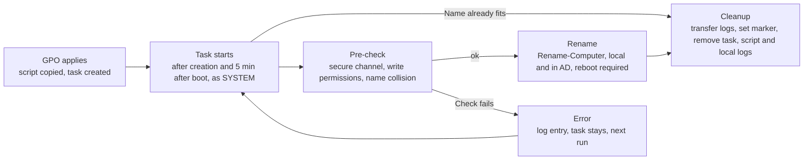

# HostRename – Operations Guide

[Deutsche Version](README.de.md)

Version 1.2.0 · As of: 3 November 2026

## Overview

HostRename automatically renames domain-joined Windows clients and also renames the corresponding AD computer object. The current renaming logic builds the new name from a template: prefix and suffix around the existing name and/or the device's serial number. By default a fixed prefix is prepended (`PC1234` becomes `NG-PC1234`); names longer than 15 characters are truncated or skipped.

Deployment is done by GPO: it copies the script from a central share to the client and creates a scheduled task there. After a successful rename, the task, the script and the local log files remove themselves. Every step ends up in a central CSV log that can be filtered per device. Alternatively, the deployment tool ACMP can run the scripts (see "Deployment via ACMP"); GPO and ACMP are alternative methods and never run on the same device.

The product name is deliberately neutral: the renaming rule lives only in `Invoke-HostRename.ps1` and can be replaced later without touching share, delegation, GPO shell and logging.

## Components

HostRename consists of two scripts (preparation and client), two reusable building blocks (network gate, certificate renewal), six Pester test files and a sample configuration for the tests. Each script has built-in help with all parameters and examples, for instance `Get-Help .\Prepare-HostRename.ps1 -Full`. Scripts, tests and sample configuration deliberately sit together in the repository root: they find each other through their folder, and the preparation script writes the test configuration next to them.

| File | Purpose | Where it runs |
| --- | --- | --- |
| `Prepare-HostRename.ps1` | Preparation: creates or removes share, AD delegation and GPO (`-Action Setup` or `Remove`). Checks the renaming rule and shows example names. Multiple OUs possible, single ones via -OuDN. Optionally a cleanup GPO at the end (`-Component CleanupGpo`). All paths as variables, writes `HostRename.Checks.psd1` | `Share` on the file server; `Delegation`, `Gpo` and `CleanupGpo` on an admin PC with RSAT or a DC (see "Share and GPO on separate machines"); once, elevated PowerShell |
| `Invoke-HostRename.ps1` | Client script: pre-checks, renaming by name template (prefix, suffix, serial number), logging, self-cleanup; `-Deployment Gpo` (default) or `Acmp` | Client, via scheduled task as SYSTEM (GPO) or run by the ACMP agent as SYSTEM |
| `Test-DeploymentNetwork.ps1` | Network gate: determines whether the device reaches the domain over LAN cable, DirectAccess or only the corporate WLAN; exit code 0/20/21/22/1 and one summary line. Standalone, reusable | Client, as SYSTEM before an action (ACMP) |
| `Update-ComputerCertificate.ps1` | Requests a new machine certificate from a template when the existing one lacks the current DNS name (after a rename); `-RemoveOld` removes outdated ones. Standalone, reusable | Client, as SYSTEM after the reboot (ACMP) |
| `HostRename.Checks.psd1` | Test configuration. Written by the preparation script during setup and therefore not in the repository (`.gitignore`); `HostRename.Checks.beispiel.psd1` shows the structure | next to the test files |
| `HostRename.Dc.Tests.ps1` | Pester: schema, delegation, GPO/SYSVOL, shares (read-only) | DC or admin PC |
| `HostRename.Client.Tests.ps1` | Pester: SYSTEM context, permission check, shares, GPO application, preview of the target name, deployment state | Pilot client |
| `HostRename.Local.Tests.ps1` | Pester: syntax, CSE GUIDs, icacls, self-deletion of a task, name templates, serial number rating, future ID | DC and client |
| `HostRename.Network.Tests.ps1` | Pester (mocks): network gate, detection and exit codes | any machine, no AD needed |
| `HostRename.Certificate.Tests.ps1` | Pester (mocks): certificate renewal | any machine, no AD or CA needed |
| `HostRename.Acmp.Tests.ps1` | Pester (mocks): ACMP mode, optional central log, reporting values | any machine, no AD needed |

Names in the system:

| Object | Name |
| --- | --- |
| GPO | `COMP - HostRename` |
| Cleanup GPO (optional, at the end) | `COMP - HostRename Cleanup` |
| Scheduled task | `HostRename` |
| Share (server) | `\\<Server>\HostRename$` on `C:\HostRename` with the folders `scripts` and `log` |
| Local folder (client) | `C:\Program Files\HostRename` |
| Registry marker (client) | `HKLM\SOFTWARE\HostRename` |
| Central log | `\\<Server>\HostRename$\log\rename-log.csv` |
| Local log (client) | `C:\Program Files\HostRename\rename-local.csv` (ACMP mode: `C:\ProgramData\HostRename\rename-local.csv`) |
| State and reporting (client) | `HKLM\SOFTWARE\HostRenameState` with original name, target name, template and the reporting values of the last run |

## How it works

Each device is renamed exactly once; afterwards HostRename removes itself.



Flow per device in words: GPO applies (script copied, task created) → task starts (immediately after creation and 5 minutes after every boot, as SYSTEM) → pre-check (secure channel, write permissions, name collision) → rename (`Rename-Computer`, local and in AD, reboot required) → cleanup (transfer logs, set marker, remove task, script and local logs). If the name already matches the template, the task jumps straight to the cleanup. If a check fails, it writes an error to the log and runs again next time.

For templates with {Serial}, the task first determines the serial number (a future ID if there are problems). Before any change it checks the secure channel, the write permissions on its own AD object and the name collision in AD.

If the template yields more than 15 characters, it truncates only the placeholder values (default: at the end, `TruncateEnd`) and logs this as `TRUNCATE`. The cleanup runs only after all log lines have arrived on the share. It first sets the registry marker so that the GPO does not recreate task and script. Then it deletes task and script. It removes the local log files and the empty folder only after the last entry (`CLEANUP_DONE`) has also arrived on the share; if delivery stalls, the local logs remain as evidence.

## Name templates

The renaming rule is a template with the placeholders `{Name}` (current hostname) and `{Serial}` (serial number). It is set in `Prepare-HostRename.ps1` as `$NameTemplate`; without a template, `$Prefix` and `$Suffix` apply around the current name.

| Template | Result for `PC349219` with serial number `PF2ABCDE` |
| --- | --- |
| `DE{Serial}` | `DEPF2ABCDE` |
| `NG-{Name}` (equivalent to `$Prefix = 'NG-'`) | `NG-PC349219` |
| `{Name}-W11` (equivalent to `$Suffix = '-W11'`) | `PC349219-W11` |
| `DE-{Serial:-6}` | `DE-2ABCDE` |
| `DE{Serial}-{Name:-4}` | `DEPF2ABCDE-9219` |

- **Length per placeholder:** `{Serial:8}` takes the first 8, `{Serial:-8}` the last 8 characters; likewise `{Name:4}` and `{Name:-4}`.
- **Serial number:** It comes from the BIOS, otherwise from the system product, otherwise from the mainboard, and contains only A–Z and 0–9. Vendor placeholders such as "To Be Filled By O.E.M." or "Default string", values under 4 characters and values consisting of a single character are discarded. If there is no usable one, the future ID applies (see below; event `SERIAL_FALLBACK`). On virtual machines, serial numbers can be long or not unique.
- **Truncation:** Only the placeholder values are truncated, the last one first: with `TruncateEnd` at the end, with `TruncateStart` at the start. Fixed characters of the template are preserved.
- **Target name:** at most 15 characters from A–Z, 0–9, `_` and `-`; it neither starts nor ends with `-` and does not consist of digits only. The collision check in AD applies to the final name; for templates without {Serial}, a name that is already taken leads to `COLLISION`.
- **Already renamed devices:** For prefix and suffix, the script recognizes them by the pattern; for templates without `{Name}`, by the computed target name. For templates with `{Name}` and `{Serial}`, it remembers original and target name in `HKLM\SOFTWARE\HostRenameState`.
- **Future ID:** If the serial number is unusable or the target name is already taken in AD (duplicate serial number), a generated ID replaces the placeholder `{Serial}`. By default it has 8 characters from A–Z without I and O plus 2–9 and is computed stably from the MachineGuid; the same machine therefore always gets the same ID. If the name with the ID is also taken, the script forms a new ID with the next counter (up to 5 attempts, then `COLLISION`). This is controlled by `$OnSerialProblem` (`GenerateId` or `Skip`) and `$FutureIdLength` (4 to 12). With `Skip`, the device skips the rename (`SERIAL_INVALID`, exit code 5) or aborts on a collision.
- **New template, new rename:** The remembered state only applies to the same template. If you change the template, devices that were already renamed are renamed again on the next run. For that, the marker `HKLM\SOFTWARE\HostRename` must be missing on the client (see Rollback), otherwise the GPO does not recreate script and task.

## Setup

Setup takes seven steps; the disabled GPO link separates pilot and rollout.

**Prerequisites:** The target environment is Windows PowerShell 5.1, which is present on all servers and clients; PowerShell 7 works in addition. `Prepare-HostRename.ps1` restarts itself in 5.1 when run under PowerShell 7, because the AD and GPO modules and the `AD:` drive are reliably available only there. The DC tests run only in 5.1 (`powershell.exe -NoProfile -Command "Invoke-Pester -Path .\HostRename.Dc.Tests.ps1 -Output Detailed"`). The task on the clients always starts `powershell.exe` (5.1). After extracting the ZIP, unblock the files, otherwise the execution policy may block them:

```powershell
Get-ChildItem .\* -Include *.ps1,*.psd1 | Unblock-File
```

### 1. Configure the preparation script

`Prepare-HostRename.ps1` creates or removes share, AD delegation and GPO. All paths and names are variables in the block "ADJUST HERE" at the start of the script. Check at least: `$ShareServer`, `$ShareRoot`, `$ClientOuDN` (list, multiple OUs possible), `$NameTemplate` (or `$Prefix`/`$Suffix`), `$SecurityFilterGroup` (pilot group with computer accounts) and `$LinkTargetOU` (leave empty as long as no link is wanted). `Invoke-HostRename.ps1` must sit next to the script so that it is copied to the share. All script and configuration files are saved as UTF-8 with BOM; Windows PowerShell 5.1 needs this, otherwise special characters and dashes are read incorrectly and the script aborts with parser errors. Keep the encoding when editing (in VS Code: "UTF-8 with BOM").

### 2. Dry run

On the target server, start in a PowerShell with "Run as administrator" (the token's UAC filtering would otherwise reject access to the share and the ACLs):

```powershell
.\Prepare-HostRename.ps1 -Action Setup -WhatIf
```

### 3. Create

```powershell
.\Prepare-HostRename.ps1 -Action Setup
```

The script first checks the renaming rule and shows example names (also with -WhatIf). Then it creates, in this order, the share (folder, NTFS permissions, share, `rename-log.csv` with header, copy of the client script), sets the delegation (with ACL backup) and creates the GPO. Afterwards it writes `HostRename.Checks.psd1` for the tests. If file server and GPO administration are on different machines, the script runs once per machine; see "Share and GPO on separate machines" below.

`$ClientOuDN` is a list: the delegation is set for each OU. Individual OUs can be added or withdrawn later, including ones that are not in the list, with `-OuDN`:

```powershell
.\Prepare-HostRename.ps1 -Action Setup  -Component Delegation -OuDN 'OU=Notebooks,DC=contoso,DC=com'
.\Prepare-HostRename.ps1 -Action Remove -Component Delegation -OuDN 'OU=Notebooks,DC=contoso,DC=com'
```

If an OU is missing in AD, the script asks for another OU (distinguished name); an empty input aborts the run. With `-Force` or without a console, it skips the OU, processes the others and aborts with an error at the end.

### Share and GPO on separate machines

A single run for everything works only if all components are on the same machine. If the share is on a file server and GPO and delegation are maintained from an admin PC or a DC, you start the script on each machine with the matching component. They work differently:

| Component | Works on | Therefore runs on | Needs |
| --- | --- | --- | --- |
| `Share` | the local machine: folder, NTFS permissions, share, copy of the client script | the file server | local administrator, elevated PowerShell; no AD module |
| `Delegation` | AD (ACL of the OU) | admin PC with RSAT or DC | ActiveDirectory module, right to change the OU ACL (domain admin) |
| `Gpo` | AD and SYSVOL (via UNC) | admin PC with RSAT or DC | GroupPolicy and ActiveDirectory modules, domain admin; the share should be reachable |

Procedure:

1. Provide the repository on both machines (`git clone` or ZIP download; for a ZIP, apply `Unblock-File` to the files first) and enter **the same values in both copies** in the block "ADJUST HERE". The decisive one is `$ShareServer`: it holds the **name of the file server**. The default is the machine the script runs on and would be wrong on the admin PC. In addition there are `$ShareRoot`, `$ShareName`, `$ClientOuDN`, the renaming rule and the task settings.
2. On the file server: `.\Prepare-HostRename.ps1 -Action Setup -Component Share`
3. On the admin PC or DC: `.\Prepare-HostRename.ps1 -Action Setup -Component Delegation, Gpo`. The GPO creation checks whether the source folder `\\<Fileserver>\HostRename$\scripts` is reachable and warns otherwise; the GPO is created anyway. The script also warns if `$ShareServer` is the local machine and no share exists there.
4. Tests: DC tests on the admin PC or DC (they access the share via UNC and therefore need administrator rights on the file server), Local tests on every machine involved, Client tests on the pilot device.

Notes:

- On a DC it works the same way. An admin PC is preferable so that no scripts, configuration files and ACL backups (folder `AclBackup`) are left on the DC.
- `HostRename.Checks.psd1` is created on each machine from its variables; if the variables are the same, the files are the same. For the tests, the file on the machine where they run counts.
- Script update: The client script lives on the file server. Copy a new version of `Invoke-HostRename.ps1` to the file server and run `-Action Setup -Component Share` there again (or copy the file directly to `\scripts`); the GPO then distributes it.
- A changed renaming rule affects only the GPO and thus only the admin PC or DC: recreate the GPO, the file server stays untouched.
- Removal: `-Action Remove -Component Gpo, Delegation` on the admin PC or DC, `-Action Remove -Component Share` (optionally `-RemoveData`) on the file server.

### 4. Verify

Run the Pester tests for DC and `Local` (section Tests) and fix all errors before any client is affected.

### 5. Pilot

Link the GPO, run `gpupdate /force` on the pilot device and start `HostRename.Client.Tests.ps1` (phase PreRun; it also shows which name the pilot device would receive). The task starts immediately when the GPO creates it (registration trigger), and afterwards 5 minutes after every reboot (boot trigger). Manually it starts immediately with `Start-ScheduledTask -TaskName HostRename`. After the reboot, check the phase PostRun.

```powershell
New-GPLink -Name 'COMP - HostRename' -Target '<OU-DN>' -LinkEnabled Yes
```

### 6. Rollout

Extend the security filtering to further groups or remove it. The task starts immediately when the GPO creates it, and afterwards at every boot with a 5-minute delay until the device is renamed. The GPO creates it with the action Create (`$TaskItemAction = 'C'`) and does not rewrite it on every processing; with Update it did not start after a reboot. Without `$Reboot`, the client keeps the old name until the next reboot, even though the AD object has already been renamed.

### 7. Completion

Once all devices are renamed, clean up in this order. The order matters: the cleanup GPO deletes marker and state on the clients. If the main GPO is still active then, it recreates script and task on finished devices, and for templates with `{Name}` and `{Serial}`, those devices would even be renamed again without state.

1. **Check whether all devices are finished.** This query lists renamed devices that have no `CLEANUP_DONE` in the central log yet (cleanup deferred or not yet run). Do not continue as long as devices are in the list:

   ```powershell
   $log  = Import-Csv '\\<Server>\HostRename$\log\rename-log.csv' -Delimiter ';'
   $done = $log | Where-Object Event -eq 'CLEANUP_DONE' | Select-Object -ExpandProperty MachineGuid -Unique
   $log | Where-Object { $_.Event -eq 'RENAMED' -and $_.MachineGuid -notin $done } | Select-Object ComputerName, TargetName, MachineGuid
   ```

2. **Remove the main GPO and the delegation** (admin PC or DC):

   ```powershell
   .\Prepare-HostRename.ps1 -Action Remove -Component Gpo, Delegation
   ```

3. **Optional: create the cleanup GPO** if the registry keys on the clients are to disappear:

   ```powershell
   .\Prepare-HostRename.ps1 -Action Setup -Component CleanupGpo
   ```

   For each key in `$CleanupRegistryKeys` it contains one registry item with the action Delete (default: `HKLM\SOFTWARE\HostRename` and `HKLM\SOFTWARE\HostRenameState`). Link and security filter match the main GPO (`$LinkTargetOU`, `$SecurityFilterGroup`); the link is initially disabled. The script refuses to create it as long as the main GPO exists (`-Force` overrides this) and accepts only keys whose last part starts with `HostRename`.
4. **Enable the link:** `Set-GPLink -Name 'COMP - HostRename Cleanup' -Target '<OU-DN>' -LinkEnabled Yes`
5. **Wait and verify.** The devices must process the policy (refresh, a reboot is safest). On a device, `Test-Path HKLM:\SOFTWARE\HostRename` must then return `False`.
6. **Remove the cleanup GPO:** `.\Prepare-HostRename.ps1 -Action Remove -Component CleanupGpo`

Share and logs remain. The cleanup GPO is not part of the default of `-Component`: without it, `-Action Remove` does not remove it.

## Deployment via ACMP

As an alternative to the GPO, the deployment tool ACMP can run the scripts on the clients (as SYSTEM). GPO and ACMP are alternative deployment methods: never use both on the same device, and do not link the GPO to devices that get the ACMP Client Command. In ACMP mode (`Invoke-HostRename.ps1 -Deployment Acmp`), ACMP controls the reboot (exit code 3010 is the signal), the local logs go to `C:\ProgramData\HostRename`, the cleanup never deletes the script file, and the central CSV log is optional (`-CentralLogPath ''`). Renaming happens only over LAN cable or DirectAccess, which `Test-DeploymentNetwork.ps1` checks beforehand; `Update-ComputerCertificate.ps1` renews the WLAN machine certificate after the rename and reboot. The delegation (`-Action Setup -Component Delegation`) is still required; the share only if the central log is used.

Step-by-step build instructions, parameters and the exit-code contract: [docs/acmp-guide.md](docs/acmp-guide.md). Device test plan: [docs/test-plan.md](docs/test-plan.md). Background and decisions: [docs/acmp-deployment-plan.md](docs/acmp-deployment-plan.md).

## Permissions

All client access runs as the computer account (SYSTEM); the group is called Domänencomputer on German servers (Domain Computers). Share permission and NTFS permission apply together; the intersection is effective.

| Location | Principal | Share | NTFS | Reason |
| --- | --- | --- | --- | --- |
| `HostRename$` | Domain Computers | Change | – | The folder permissions limit access per folder |
| `HostRename$` | Administrators | Full control | – | Administration |
| `C:\HostRename` | Administrators, SYSTEM | – | Full control, inheritance removed | Base for both subfolders |
| `\scripts` | Domain Computers | – | Read and execute | GPP copies the script as the computer account. No write access, because the script runs as SYSTEM on all clients |
| `\log` | Domain Computers | – | Write/append data, read/write attributes, read permissions (icacls `WD,AD,WEA,WA,RA,RC,S`); no reading of contents, no deleting | Appending to the central CSV. Appending via .NET and SMB needs more than "write and append data" and otherwise ends in "access denied"; in practice "read attributes" was missing (the base right `W` was not enough either). No read access, so devices cannot see other devices' logs |

**Why not "Everyone: Full control" on the share?** Both are permissible. The classic approach sets the share to "Everyone" with full control and regulates everything via NTFS; the effective permission is always the intersection of share and NTFS permission anyway. HostRename additionally restricts the share by default (`$ShareAccessMode = 'Restricted'`): only domain computers and administrators reach it at all, user accounts are rejected at share level. With `$ShareAccessMode = 'Everyone'` the classic approach applies; the NTFS permissions in the table then provide the separation alone. Running setup again aligns the permissions of an existing share with the chosen mode.

AD delegation by `Prepare-HostRename.ps1`: on each configured client OU, `NT AUTHORITY\SELF` receives the following rights, limited to child computer objects (not the OU itself). Each computer account can thereby rename only its own object.

| Right | Purpose |
| --- | --- |
| Write `cn`, `name` | Renaming the object (RDN) |
| Write `sAMAccountName` | New account name with `$` |
| Write `displayName` | Display name |
| Validated write to DNS host name | Adjusting `dNSHostName` |
| Validated write to service principal name | Adjusting the SPNs |
| Reset password | New password of the computer account after renaming (the Kerberos keys depend on the name); without this right, `Rename-Computer` often fails with "access denied" |
| Write Account Restrictions | Account settings (property set) that Windows adjusts when renaming |

The delegation script is run by a domain admin or an account with the right to change the OU's ACL. Before each change it backs up the existing ACL in the folder `AclBackup`.

## Logging

Every event, whether success or error, ends up as one line in `\\<Server>\HostRename$\log\rename-log.csv` (semicolon, UTF-8, timestamp in ISO 8601 with time zone). If the share is unreachable, the entry stays local in `pending.csv` and is delivered on the next run. Parallel appending by several devices is handled by a retry with exclusive write access.

Columns: `Timestamp; Level; Event; ComputerName; TargetName; Serial; MachineGuid; Message`. `Serial` and `MachineGuid` stay stable after the rename so that a device's history can also be found under the new name.

| Event | Meaning |
| --- | --- |
| `START`, `TRUNCATE` | Run started (the message names the script version, e.g. "HostRename 1.2.0: deployment Gpo, template …"), name truncated to 15 characters |
| `PERM_CHECK`, `PERM_DENIED` | Write permissions on the own AD object checked or missing (exit code 4) |
| `COLLISION`, `TOO_LONG`, `DNS_EXISTS` | Target name taken in AD, too long (with `Skip`), present in DNS (warning only) |
| `RENAMED`, `AD_VERIFY`, `REBOOT` | Rename done, AD verification, reboot scheduled |
| `PENDING_REBOOT`, `ALREADY_DONE` | Rename waiting for reboot, or name already matches the template (local only) |
| `REBOOT_IGNORED` | `-Reboot` was given with `-Deployment Acmp` and is ignored (warning); ACMP controls the reboot, exit code 3010 is the signal |
| `CLEANUP`, `CLEANUP_DONE`, `CLEANUP_DEFERRED`, `CLEANUP_FAILED` | Self-cleanup of task, script and local log files |
| `WHATIF` | Test run with `-WhatIf`: reports the target name, changes nothing |
| `RENAME_FAILED`, `PRECHECK` | Error during rename, or failed pre-check |
| `SERIAL`, `SERIAL_FALLBACK`, `SERIAL_INVALID` | Serial number determined; future ID used instead of serial number (unusable or duplicate); `SERIAL_INVALID` only with `OnSerialProblem Skip` (exit code 5) |
| `CONFIG`, `TEMPLATE`, `NAME_INVALID` | No rule given, unknown placeholder, or invalid target name |
| `STATE` | State (`HostRenameState`) could not be saved after the rename (warning only) |
| `LOG_DELIVERY` | Central log not writable; the reason is in the local log, the entries stay in `pending.csv` (local only, once per run) |
| `LOG_CHECK` | Pre-check of the central log before renaming (name resolution, port 445, write permission); the result is only in the local log, the rename continues in any case |

Queries:

```powershell
$log = Import-Csv '\\<Server>\HostRename$\log\rename-log.csv' -Delimiter ';'

# Everything about one device (old or new name)
$log | Where-Object { $_.ComputerName -in 'PC1234','NG-PC1234' -or $_.TargetName -eq 'NG-PC1234' } | Sort-Object Timestamp

# Unambiguous by hardware ID
$log | Where-Object { $_.Serial -eq 'ABC123' -or $_.MachineGuid -eq '<GUID>' }

# Errors only
$log | Where-Object Level -eq 'ERROR'
```

Exit codes of `Invoke-HostRename.ps1`: `0` nothing to do or WhatIf, `3010` renamed and reboot required, `2` skipped (name too long), `4` no permission on the own AD object, `5` no usable serial number (only with `OnSerialProblem Skip`), `1` other error. The central log is optional: with `-CentralLogPath ''` only the local log is written (the local log files are then kept, and the cleanup is never deferred because of log delivery).

## Tests

The Pester checks clarify what could not be verified without a real environment. Pester 5.3 or newer is required (`Install-Module Pester -MinimumVersion 5.3 -Force -SkipPublisherCheck`). All files sit in the same folder as the scripts, and `HostRename.Checks.psd1` is written by `Prepare-HostRename.ps1` during setup and matches the environment. After every change of the variables (template, prefix, paths), run setup again so that the tests check with the same values as the GPO; a `git pull` or re-extracting does not overwrite the file because it is not in the repository.

| File | Runs on | Checks |
| --- | --- | --- |
| `HostRename.Dc.Tests.ps1` | DC or admin PC with RSAT, read-only | Schema GUIDs of the validated writes, delegation on the OU, GPO status, SYSVOL files, CSE entry, AD version against `GPT.INI`, detection by `Get-GPOReport`, NTFS permissions of the shares; the cleanup GPO if present |
| `HostRename.Local.Tests.ps1` | DC and client, as administrator | Syntax of all scripts, CSE GUIDs of the preferences (Files, Scheduled Tasks, Registry) in the registry, icacls commands, self-deletion of a running task, name templates, serial number rating and future ID (loaded from `Invoke-HostRename.ps1`) |
| `HostRename.Client.Tests.ps1` | Pilot client, as local administrator | Computer account context (SYSTEM), real permission check on the own AD object, access to both shares, GPO application, preview of the target name with the device's serial number or future ID, deployment state |
| `HostRename.Network.Tests.ps1` | any machine, no AD needed | Network gate: detection of LAN, DirectAccess, WLAN and domain reachability (mocked), decision and exit codes, result line |
| `HostRename.Certificate.Tests.ps1` | any machine, no AD or CA needed | Certificate renewal: SAN parsing, template detection, renewal and removal decisions with a mocked store and enrollment |
| `HostRename.Acmp.Tests.ps1` | any machine, no AD needed | `-Deployment` parameter, local folder per mode, disabled central log, cleanup decisions per mode, reporting values |

```powershell
Invoke-Pester -Path .\HostRename.Dc.Tests.ps1 -Output Detailed
Invoke-Pester -Path .\HostRename.Local.Tests.ps1, .\HostRename.Client.Tests.ps1 -Output Detailed

# AD-free tests (mocks), also on a developer machine or in CI
Invoke-Pester -Path .\HostRename.Local.Tests.ps1, .\HostRename.Network.Tests.ps1, .\HostRename.Certificate.Tests.ps1, .\HostRename.Acmp.Tests.ps1 -Output Detailed

# after rename and reboot of the pilot
$c = New-PesterContainer -Path .\HostRename.Client.Tests.ps1 -Data @{ Phase = 'PostRun' }
Invoke-Pester -Container $c -Output Detailed

# Proof for item-level targeting, only on the pilot and before the first run
$c = New-PesterContainer -Path .\HostRename.Client.Tests.ps1 -Data @{ RunIltRoundtrip = $true }
Invoke-Pester -Container $c -Output Detailed
```

The client test briefly creates temporary SYSTEM tasks and writes a test file `pester-write-test-<PC>.csv` to the log share. An administrator deletes leftover test files. The roundtrip test temporarily removes task and script on the pilot; the GPO recreates both.

## Security and known limitations

The biggest risk is the source share: the script runs as SYSTEM on all clients, so whoever can change it there executes code on all devices. Therefore only administrators may write to `\scripts`.

- **Delegation:** A device with local admin rights can rename its own AD object to a free name within the OU. Therefore limit the delegation to the client OU and remove it after the rollout with `-Action Remove -Component Delegation`.
- **ACMP:** Whoever can change the scripts in the ACMP file repository runs code as SYSTEM on all devices that get the Client Command; restrict write access there like on `\scripts`. In ACMP mode the local logs sit in `C:\ProgramData\HostRename`; check the ACL of that folder (see "Local folder").
- **Local folder:** `C:\Program Files\HostRename` is protected by the default ACL: standard users may not create or change anything there, so `$HardenLocalFolder = $false` is the default and the task runs no icacls actions. The same applies to the local logs (`-LocalDir`) that SYSTEM writes to. If the folder is in an area writable by users such as `C:\ProgramData`, set `$HardenLocalFolder = $true`: the task then locks it with icacls before every run (owner Administrators, write only for SYSTEM and Administrators). A pre-created folder, a junction and the time window until the first run remain a residual risk in that case.
- **Reboot:** After `Rename-Computer`, the AD object is renamed immediately, but the client keeps the old name until the reboot. During that time computer name and computer account do not match. Without `$Reboot`, the devices' regular reboot cycle must be short.
- **Permission check:** `Invoke-HostRename.ps1` reads `allowedAttributesEffective` and thereby checks write permissions on `cn` and `sAMAccountName`. The validated writes for DNS host name and SPN cannot be checked reliably this way; if they are missing, `Rename-Computer` reports the error and it appears in the log.
- **Cleanup:** It runs only after all log lines have arrived on the share. On an error or missing permissions, the task stays and tries again.
- **Marker and targeting:** The GPP items have item-level targeting on `HKLM\SOFTWARE\HostRename` so that the GPO does not recreate task and script after the cleanup. The roundtrip test in the client check proves that the targeting works.
- **Serial numbers in hostnames:** A name derived from the serial number makes it visible to everyone in AD and DNS. If that is undesirable, use `{Serial:-6}` or a combination with `{Name}`. On virtual machines, BIOS serial numbers are often long or not unique; check the preview in the client test before the rollout. Duplicate or unusable serial numbers are replaced by a generated future ID.
- **Cleanup GPO:** It deletes entire registry keys including contents on all clients. The script therefore allows only keys whose last path part starts with `HostRename` and refuses to create it as long as the main GPO exists.
- **System language:** Principals are specified in a language-independent way: by SID (delegation, icacls, tests) or as `SYSTEM` and `S-1-5-18` (task). Names such as "NT AUTHORITY\System" apply only on English systems; a GPO with an English account name does not create the task on German clients (event 1085 in the System log). If you have an older GPO, recreate it.
- **Task start:** The registration trigger starts the task immediately when the GPO creates it, without delay: a delay element in the trigger would make the GPO's HTML report fail in the GPMC. In theory the task can start before the GPO has created the script copy; that run then fails, and the boot trigger (5 minutes) catches up on the next reboot.

**Test status:** In the pilot on a Windows 11 client with German system language, everything implemented so far is confirmed to work: delegation and renaming (with the rights Reset password and Account Restrictions), the language-independent task account, the replacement of the script copy by the GPO (action Replace), the start of the task in the current construction (immediately after creation and 5 minutes after a reboot), the task deleting itself including the marker, the cleanup of the local files after the logs have been delivered, appending to the central log with exactly the permission set applied by setup, the Dc and Client Pester tests, the GPMC settings report of the current GPO, the item-level-targeting roundtrip test and the cleanup GPO.

Everything added in 1.2.0 (ACMP mode, network gate, certificate renewal, optional central log, reporting values) is tested only with mocks (Linux, PowerShell 7) and has not run on real devices or in ACMP yet. The GPO path is unchanged by design, but the 1.2.0 client script still needs a regression test in the pilot. The device test plan is [docs/test-plan.md](docs/test-plan.md).

## Operations

Three things are worth knowing in operation: how to roll back, where to look for errors and how to change the renaming rule.

### Rollback

- Remove the server side completely (GPO including links, delegation, share): `.\Prepare-HostRename.ps1 -Action Remove`. Folders and logs remain.
- Also delete the folders: additionally `-RemoveData`. The log file is copied to `$LogArchiveDir` beforehand. Individual parts with `-Component Gpo`, `Delegation` or `Share`.
- The ACL backup of the OU is in the folder `AclBackup`.
- Remove the cleanup GPO: `-Action Remove -Component CleanupGpo` (it is not part of the default of `-Component`).
- Remove the marker on a client if the device is to be processed again: `Remove-Item HKLM:\SOFTWARE\HostRename, HKLM:\SOFTWARE\HostRenameState -Recurse`.

### Registry on the client

| Key | Values | Purpose |
| --- | --- | --- |
| `HKLM\SOFTWARE\HostRenameState` | `TargetName`, `Template` | State after the rename; the logic reads both: a device counts as done if its name matches `TargetName` and the template is the same. With a different template it is renamed again |
| | `OriginalName`, `Applied`, `FutureId` | evidence only: name before the rename, time, future ID used (empty if none) |
| | `LastRun`, `LastExitCode`, `LastEvent`, `Deployment`, `ScriptVersion` | reporting values, written at the end of every run (not with `-WhatIf`), e.g. for ACMP custom fields: time, exit code, last event code logged (e.g. `RENAMED`), `Gpo` or `Acmp`, script version. The script logic never reads them |
| `HKLM\SOFTWARE\HostRename` | `Completed`, `ComputerName` | Marker that only the cleanup sets: the GPO no longer creates script and task as soon as the key exists |

**`HostRenameState` now exists after every run** because of the reporting values, so its existence does not mean "done". A device is done when the marker `HKLM\SOFTWARE\HostRename` exists (set by the cleanup); `TargetName` shows that the rename has happened. The two keys are separate because the marker works through its mere existence. If the state were in the same key, the GPO would stop applying script and task right after the rename, before the cleanup. After the rollout is complete, the optional cleanup GPO removes both keys on all clients (see Completion).

### Troubleshooting

| Symptom | Cause and check |
| --- | --- |
| `PERM_DENIED` in the log (exit code 4) | Delegation is missing or does not apply to the device's OU. Check the Dc test section Delegation |
| `COLLISION` | Target name exists in AD, also through truncation or identical serial numbers. Choose a different template or `-OnTooLong TruncateStart` |
| Device is not processed | GPO not linked, security filter excludes the device, or the marker exists. Check `gpresult /scope computer /r` and the registry marker |
| Log entries are missing | Share unreachable or permissions missing. The reason is given by the event `LOG_DELIVERY` in `rename-local.csv`; often the NTFS permissions for Domain Computers on the folder `log` are missing (`WD,AD,WEA,WA,RA,RC,S`; a single file with old permissions is reset by `icacls <file> /reset`): run setup for the share again (`-Action Setup -Component Share`). Entries stay in `C:\Program Files\HostRename\pending.csv` and are delivered later |
| Task and script remain after success | Read `CLEANUP_DEFERRED` or `CLEANUP_FAILED` in the local log `rename-local.csv` |
| `SERIAL_FALLBACK` in the log (warning) | Serial number unusable or duplicate: the device received a future ID, the name is unique and stable. The cause is in the message (discarded BIOS values or the existing name in AD). With `OnSerialProblem Skip`, `SERIAL_INVALID` appears instead (exit code 5) |
| Task missing on the client, event 1085 (GroupPolicy) in the System log | A preference was not applied. The most common cause was an English account name in the task on a German client; the current GPO uses `SYSTEM` or the SID. Recreate the GPO (`-Action Remove -Component Gpo`, then Setup). Details: Event Viewer under Microsoft > Windows > GroupPolicy > Operational and `gpresult /h` |
| Task is created but shows "The task has not yet run" (0x41303) | The task starts immediately when the GPO creates it (registration trigger) and 5 minutes after every boot. With `$TaskItemAction = 'U'`, the GPO rewrites the task at every boot and it did not start after a reboot; the default is `C` (create only if the task is missing). Delete an existing task on the device once (`Unregister-ScheduledTask -TaskName HostRename -Confirm:$false`), run `gpupdate /target:computer /force` and reboot. Check: if `LastWriteTime` of `C:\Windows\System32\Tasks\HostRename` is shortly after `LastBootUpTime`, the GPO rewrites the task at boot. Start immediately: `Start-ScheduledTask -TaskName HostRename`; the result is in `rename-local.csv` in the local folder |
| `RENAME_FAILED` with "access denied" although `PERM_CHECK` passes | The pre-check covers only `cn` and `sAMAccountName`. Another right is missing, usually Reset password: set the delegation again (`-Action Setup -Component Delegation`) and restart the task (`Start-ScheduledTask -TaskName HostRename`). Details on the client in `C:\Windows\debug\NetSetup.LOG` (lines with error code 0x5), on the DC in the Security log when auditing for directory service access is enabled |
| Event 4117 (Group Policy Files), error `0x50` when copying the script | The file copy failed to overwrite an existing local copy; the client kept the old script version. The GPO therefore uses the action Replace (confirmed in the pilot). With an older GPO, recreate it or delete the local file and run `gpupdate /target:computer /force` |
| GPMC shows on the "Settings" tab: "Unknown error while creating the HTML report" | A delay element in the task's registration trigger causes this. The current GPO creates the trigger without delay; with an older GPO, recreate it (`-Action Remove -Component Gpo`, then Setup). The GPO works on the clients even with this error |
| Creating the cleanup GPO aborts: "The main GPO still exists" | Intended protection. First run `-Action Remove -Component Gpo`; create it with `-Force` only if that is deliberately intended |
| The registry keys are still there after the cleanup GPO | Link disabled, security filter excludes the device, or the device has not processed the policy yet (reboot or `gpupdate /target:computer /force`; `gpresult /scope computer /r`). Run the Dc test section Cleanup GPO. Workaround: create the registry item by hand in the GPMC (registry item, action Delete, key path without value name) |

### Changing the renaming rule

The rule (today: name template with {Name} and {Serial}, truncated to 15 characters) is in `Invoke-HostRename.ps1` in the step that builds the target name from the template and truncates it if needed (step 3 of the main flow). Everything else stays unchanged: pre-checks, permission check, collision check in AD, logging, self-cleanup, share, delegation and GPO. If the script is to receive new parameters, they must also be added to the argument list in `Prepare-HostRename.ps1`.

Usually a different template is enough: change `$NameTemplate` in `Prepare-HostRename.ps1` and recreate the GPO (`-Action Remove -Component Gpo`, then `-Action Setup -Component Gpo`), because running setup again leaves an existing GPO unchanged. With the default action Create, the new rule does not reach existing tasks, because it is contained in the task's arguments: on devices that are not finished yet, delete the task once (`Unregister-ScheduledTask -TaskName HostRename -Confirm:$false`) and run `gpupdate /target:computer /force`. The same applies to changed reboot switches. Finished devices are not affected.

## Changes

| Version | Change |
| --- | --- |
| 1.2.0 (3 Nov 2026) | ACMP as an alternative deployment method (`-Deployment Acmp`: local logs in `C:\ProgramData\HostRename`, no reboot by the script, cleanup keeps the script file). New network gate `Test-DeploymentNetwork.ps1` and certificate renewal `Update-ComputerCertificate.ps1`. Central log optional (`-CentralLogPath ''`). Reporting values in `HostRenameState` (`LastRun`, `LastExitCode`, `LastEvent`, `Deployment`, `ScriptVersion`; the key now exists after every run), event `REBOOT_IGNORED`. Scripts and documentation in English, German documentation as an alternative. Tested with mocks only, not yet on real devices |
| 1.1.9 | Task start reworked: registration trigger (start immediately after creation, without delay) and boot trigger (5 minutes), GPP action Create by default, no daily trigger. New switches `$RegistrationTrigger` and `$RepeatInterval`; `$RegistrationDelay` is removed. When switching, recreate the GPO and delete existing tasks once on devices that are not finished yet |
| 1.1.5 to 1.1.8 | Intermediate states for the task start, merged in 1.1.9 |
| up to 1.1.4 | Initial build of the solution: preparation and client script, name templates, cleanup (also via GPO), tests |
